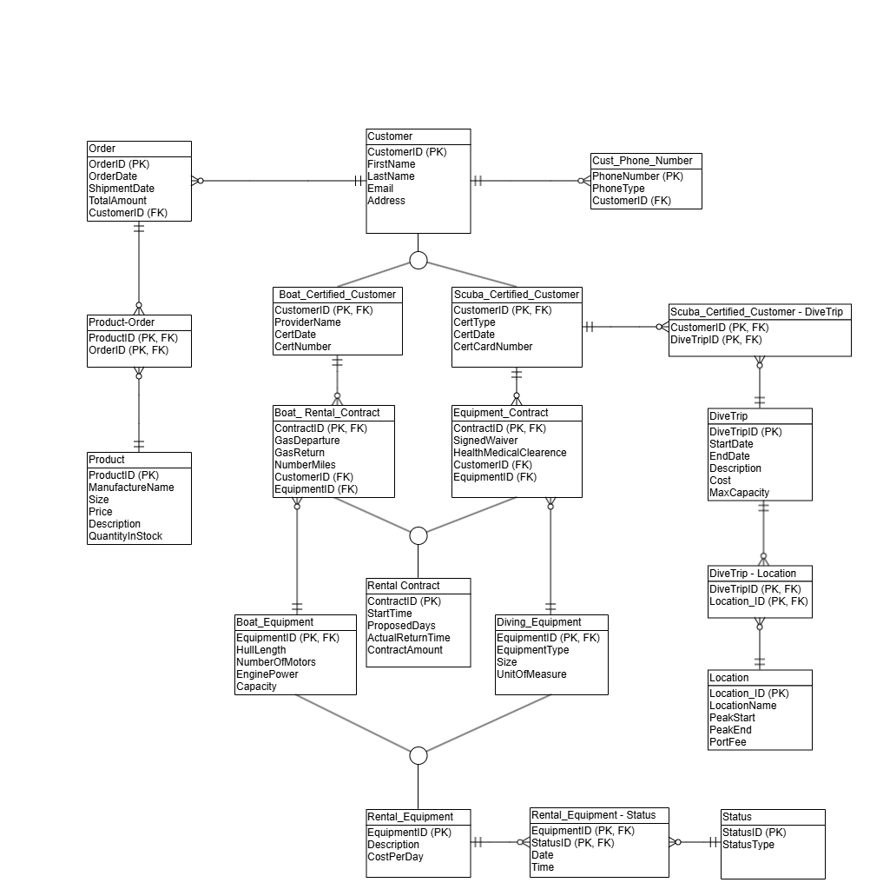

# Morgan Dive 'n' Thrive Database

A MySQL database my team and I designed for CIS 330 (Database Design & Application) at JMU.

Morgan Dive 'n' Thrive is a made-up small dive shop in Florida from our class case. They sell diving gear, run scuba dive trips, and rent out diving equipment and boats. The business grew fast and they were keeping track of everything by hand, so our job was to design a database that keeps it all organized in one place.

## What's in the database

The database has 19 tables that cover:

- Customers and their phone numbers
- Scuba certifications and boat safety certifications (kept separate since they work differently)
- Products and customer orders
- Dive trips and the locations they go to
- Rental contracts for diving equipment and boats
- Rental equipment and its status over time (Available for Rent, Rented Out, Out of Service, Removed from Service)

Some of the business rules we had to build in:

- Only certified scuba divers can go on dive trips
- Only customers with a boat safety certification can rent a boat
- Boats and diving equipment can't be on the same rental contract
- A trip can go to many locations, and a location can be on many trips

## ERD

## Files

- `schema.sql`: creates all 19 tables with primary and foreign keys
- `sample_data.sql`: fake sample data to test with
- `queries.sql`: 6 report queries
- `ERD.png`: our entity relationship diagram

## Queries

1. Rental equipment status report: every piece of equipment and its current status
2. Most rented equipment and boats
3. Average rental time for diving equipment vs. boats
4. Sales report by quarter: number of orders, total revenue, average order value, and smallest/largest order
5. How many dive trips each scuba certified customer has gone on
6. Upcoming dive trips that still have open spots

These use joins, GROUP BY, HAVING, CASE, UNION ALL, and functions like COUNT, SUM, AVG, and ROUND.

## How to run it

In MySQL (for example, MySQL Workbench), create a new database and run the files in this order:

1. `schema.sql`
2. `sample_data.sql`
3. `queries.sql`

## Team

This was a group project. Our team was Aquatic Consulting Group (Team 5) in CIS 330, Spring 2026, and we built everything together.

## Posted by

Dong Phuong Huynh (Alex), CIS student at JMU
